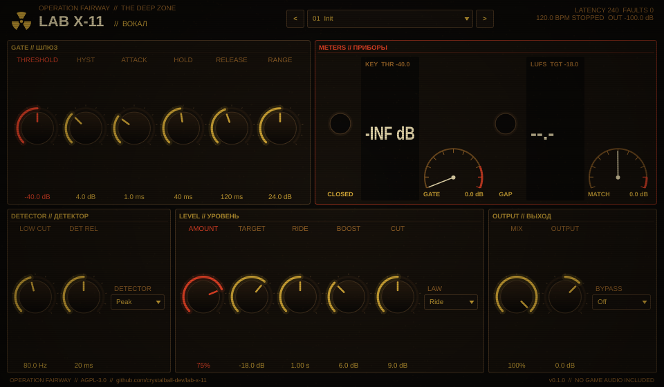

# LAB X-11

One vocal effect for an FL Studio mixer track, built as a VST® 3 plugin for Windows: a **lookahead noise gate** that
takes the room tone out between phrases while breaths and word tails pass, followed by a **level matcher** that holds
each phrase near the level the song needs, the fader ride the vocal otherwise gets by hand. The sixth LAB X- release
from OPERATION FAIRWAY, built on the [LAB X-16](https://github.com/crystalball-dev/lab-x-16) effect base, in the Deep
Zone (Oxide) look of the family.



LAB X-11 is a fan project. It is not affiliated with or endorsed by GSC Game World. This repository contains no game
audio and no samples; every test signal is synthesized.

**Status:** version 0.1.0 is built and passes its full test suite on a Linux build (see `docs/DESIGN.md`). The
FL Studio checks on Windows, the stem-based defaults and the user's listening round are still to come.

## What it does

Two stages, in this order, on the one vocal track. Nothing needs a send, a bus or a sidechain.

**GATE // ШЛЮЗ** decides on the incoming vocal and applies its gain 5 ms later, so the gate is already open when a
consonant arrives: the opening ramp lands on room tone, never on the word.

- THRESHOLD opens the gate; it closes again only below THRESHOLD minus HYSTERESIS, so a word tail hovering at the
  threshold does not chatter.
- ATTACK and RELEASE are the times for the whole move between fully closed and fully open. The gain moves at a constant
  rate in dB, so the close is even, not fast-then-slow.
- HOLD keeps the gate open after the vocal falls below the close level, counted from the audio itself.
- RANGE is how far the gate closes. 0 dB leaves the gate open: the LEVEL stage still uses it as its voice detector.

**DETECTOR // ДЕТЕКТОР** shapes what the gate listens to: LOW CUT keeps rumble and plosive thumps out of the decision,
DETECTOR picks the louder channel's peak or a 2.5 ms RMS, DET RELEASE sets how fast the peak reading falls.

**LEVEL // УРОВЕНЬ** measures the vocal's loudness (BS.1770 K-weighting, the last 400 ms of voice) and moves one slow
gain toward TARGET. It listens only while the gate is open and the sound is voiced: gaps, breaths, sibilants,
consonant bursts and hiss-like room tone hold the gain exactly where it is, so nothing is pumped up between lines.

- AMOUNT scales the whole correction: 100 % lands each phrase on TARGET, 75 % (the default) keeps a quarter of the
  line-to-line contour, 0 % turns the stage off exactly.
- TARGET is the level, in LUFS, that phrases are moved toward.
- RIDE is the time constant: the gain moves at most 6 dB per RIDE second.
- BOOST and CUT limit the correction (6 and 9 dB by default; boosting is the riskier direction).
- LAW: **Ride** moves the gain continuously (every preset uses it). **Step** is the "quantizer" reading: the gain
  sits on a 1.5 dB grid and moves only in the 5 ms before a phrase starts, like a fader set once per line.

Peak control stays with the compressors after it in the chain: the matcher has no fast path at all.

**METERS // ПРИБОРЫ**: the gate lamp (OPEN, HOLD, CLOSED) and the detector's KEY level against THRESHOLD; the gate's
reduction needle; the voice lamp (VOICE when the matcher is measuring, HELD when the gate is open but the sound is not
voice, GAP when the gate is shut); the matcher's LEVEL in LUFS against TARGET; the MATCH needle.

### Setting it on a vocal

1. Put LAB X-11 in slot 1 of the vocal insert, before EQ and compression.
2. Play a gap between lines. Raise THRESHOLD until the gate lamp reads CLOSED in the gaps and OPEN on every word. The
   KEY readout shows what the detector hears. Keep THRESHOLD above hum, bleed and room rumble (HVAC, traffic): it is
   also the matcher's voice detector, and those sounds read as voice to it.
3. Play a typical verse and read LEVEL. Set TARGET to it. The average correction is then about 0 dB, so the vocal's
   fader balance against the snare and the drive into the compressors stay as they were; only the line-to-line spread
   shrinks.
4. Pick a preset first, then set TARGET: loading a preset writes TARGET too.

## Using it in FL Studio

- One instance per vocal insert. Doubles and ad-libs on their own inserts get their own instance: load Ad-lib / Double
  and copy the lead's TARGET into it (instances are not linked).
- LAB X-11 reports 5 ms of latency (its lookahead: 221 samples at 44.1 kHz, 240 at 48 kHz, 480 at 96 kHz). FL
  compensates it.
- Use the plugin's own MIX, and keep it at 100 % for the LEVEL stage: a dry blend dilutes the matching.
- Smart disable is fine: the plugin has no tail.
- If LEVEL stays at --.- while the voice lamp reads HELD on a quiet take, the take is more than 20 dB under TARGET minus
  BOOST: lower TARGET or raise BOOST.

## Signal chain

```
host in (stereo; mono duplicated by the base)
  |-- key: LOW CUT -> DETECTOR -> gate state machine -> gain and state per sample
  v
  5 ms lookahead delay -> x gate gain -> [guard GATE] -> LEVEL (voice = gate open + voiced) -> [guard LEVEL]
  v
  wet safety -> MIX against the dry signal delayed 5 ms -> OUTPUT -> BYPASS (20 ms crossfade) -> host out
```

A stage that produces a non-finite sample or a block above +42 dBFS is silenced, reset and logged by name to
`%APPDATA%\OPERATION FAIRWAY, LLC\LAB X-11 faults.log` (the SYSTEM line shows FAULTS).

## Parameters

| Id | Name | Range | Default | Notes |
|---|---|---|---|---|
| `mix` | Mix | 0..100 % | 100 % | |
| `output` | Output | -24..+12 dB | 0 dB | |
| `bypass` | Bypass | Off, On | Off | 20 ms crossfade to the aligned dry signal |
| `gate_thr` | Threshold | -80..0 dB | -40 dB | open level on the detector |
| `gate_hyst` | Hysteresis | 0..12 dB | 4 dB | close level = threshold - hysteresis |
| `gate_attack` | Attack | 0.1..50 ms | 1 ms | full open, closed to 0 dB |
| `gate_hold` | Hold | 0..500 ms | 40 ms | after the audio falls below the close level |
| `gate_release` | Release | 5..2000 ms | 120 ms | full close, 0 dB to -RANGE |
| `gate_range` | Range | 0..80 dB | 24 dB | 0 = gate open |
| `det_lowcut` | Low Cut | 20..500 Hz | 80 Hz | 20 Hz = off; detector only |
| `det_mode` | Detector | Peak, RMS | Peak | |
| `det_release` | Det Release | 1..200 ms | 20 ms | peak detector fall |
| `level_amount` | Amount | 0..100 % | 75 % | 0 = off, bit-exact |
| `level_target` | Target | -40..-6 dB | -18 dB | LUFS of the voiced vocal |
| `level_time` | Ride Time | 0.5..10 s | 1 s | at most 6 dB per Ride Time second |
| `level_boost` | Max Boost | 0..18 dB | 6 dB | |
| `level_cut` | Max Cut | 0..18 dB | 9 dB | |
| `level_law` | Law | Ride, Step | Ride | |

Parameter ids and their order never change once the plugin is installed (FL saves them by index).

## Presets

| # | Preset | For |
|---|---|---|
| 0 | Init | the defaults: a floor-only gate and a gentle matcher |
| 1 | Booth Floor | the three reference lead chains as read: floor-only gate, longer hold, slow matcher |
| 2 | Room Tone | a noisier take: higher threshold, deeper range, slower release; little boost |
| 3 | Rap Lead | tight, fast delivery: short hold and release; a fast matcher with +4 / -6 dB limits |
| 4 | Soft Take | quiet, airy delivery: low threshold, shallow range; more boost allowed |
| 5 | Ad-lib / Double | a harder gate; the matcher at 100 % so the double lands on TARGET |
| 6 | Gate Only | the matcher off |
| 7 | Level Only | the gate open (RANGE 0), still detecting voice for the matcher |

## Defaults and assumptions

- **Order and placement** come from the three reference projects (DIEHARD, SCALES, GOLD): every lead take feeds one
  vocal insert, the gate is the first slot in two of three, and level consistency is otherwise bought with three or
  four serial compressors plus volume automation. LAB X-11 replaces the gate and the line-to-line part of that work;
  the compressors keep the peaks.
- **THRESHOLD -40 dB** is DD Gate's minimum threshold, where all three lead chains run it ("down to -40 dB" in its
  listing; the normalised setting was read from the project files, the mapping to dB is an assumption). It is
  provisional until the stems' noise floors are measured.
- **HOLD and RELEASE** follow the reference gates (hold 0 to 0.155 of range, release near minimum), lengthened so word
  tails survive the hysteresis. Their dB and ms mapping in DD Gate is not published; the values are provisional.
- **TARGET -18 LUFS** is provisional: it becomes the median voiced loudness of the three lead stems once they are
  measured. The vocal sits at roughly unity against the snare in all three projects (insert faders 87 to 100 %).
- The Fruity Compressor settings read from the projects are a tentative decoding and were not used for any default.
- The gate rows of the presets are provisional for the same reasons.

## Building on Windows

Visual Studio 2022 (MSVC), CMake 3.22 or newer, JUCE 9 (9.0.3 tested), Python 3 with numpy, scipy and soundfile for
the tests.

```
powershell -ExecutionPolicy Bypass -File scripts/build.ps1            # -JucePath F:/_DEV/tools/JUCE by default
python -I test/run_tests.py --all                                     # add --quick for 30 s fuzz runs
powershell -ExecutionPolicy Bypass -File scripts/validate.ps1 -Strictness 10
```

The build makes `LAB X-11.vst3`, a Standalone app for a quick look without FL, and `LabX11Render`, the offline test
harness. On Linux the same CMake builds with Ninja (`-DLABX11_JUCE_PATH=<JUCE 9>`); run the tests under `xvfb-run`.

## Installing in FL Studio

Close FL Studio, then:

```
powershell -ExecutionPolicy Bypass -File scripts/install.ps1
```

This copies the single file `LAB X-11.vst3` into `C:\Program Files\Common Files\VST3` (FL scans single files
reliably) and refuses while FL runs, while the file is in use, or when a bundle folder of the same name is there (FL
would list the plugin twice). Rescan in FL's plugin manager; LAB X-11 appears under Fx / Dynamics.

## Testing

`test/run_tests.py` drives `LabX11Render` and writes `build/test-report-x11.json`:

- **C1-C9**, the LAB X family's common checks: null at bypass, latency reported equals measured at 44.1 / 48 / 96 kHz,
  state round trip, click-free preset switch, 300 s fuzz runs at block sizes 1 to 3000, the fault guard at every stage,
  pluginval at strictness 5 and 10, CPU at least 20 times real time, and the editor snapshot.
- **T0**, 179 C++ self-tests inside the DSP headers (`LabX11Render --selftest`): every gate state transition and its
  timing to the sample, the lookahead, and the matcher's calibration, convergence, limits, freeze, burst, breath and
  sibilant rejection, Step law and block-size independence.
- **T1-T13**, renders of synthetic signals analysed with numpy: room tone removed, word tails kept, onsets intact,
  hold and release timing, latency; the matcher's convergence, limits, freeze in gaps, transients untouched,
  phrase-to-phrase consistency, the gate and matcher together, and a click-free preset switch.
- **P1**, every preset keeps the reference vocal's loudness within 1 dB.

Real vocals can be rendered with `LabX11Render --in <file.wav> --out <out.wav>`; audio never goes into the repository.

## Licence

AGPL-3.0. VST is a registered trademark of Steinberg Media Technologies GmbH.
